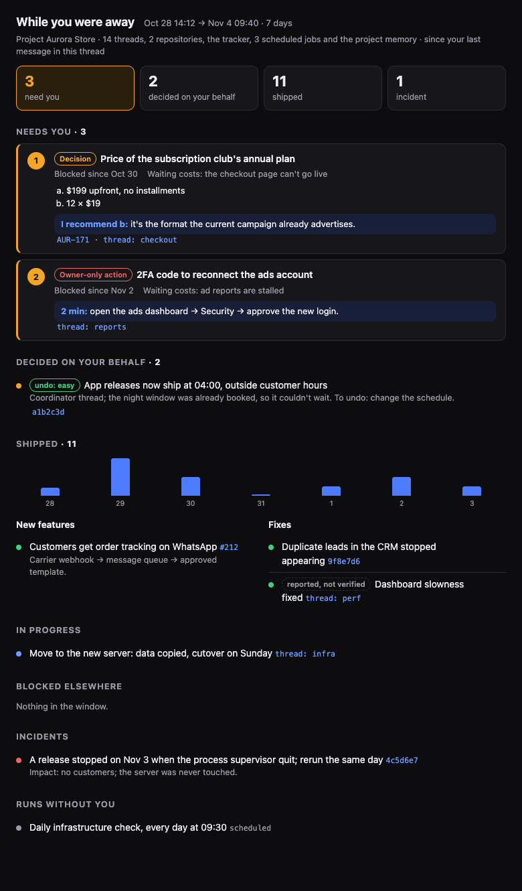

# /here

An owner check-in skill for people who run many autonomous agents and go days without looking at a project.

While you're away, agents ship features, fix bugs, hand work to each other, decide things on your behalf and stall waiting for you. When you come back, you can't read dozens of threads. You type `/here` and the agent does two things:

1. **Catches you up** with one visual page covering everything since your last message: what shipped, what's in progress, what broke, and what keeps running without you.
2. **Uses you while you're there.** It lists, numbered and with a recommendation each, everything only you can unblock: decisions, approvals, owner-only actions (passwords, 2FA, payments) and critical decisions agents made on your behalf. You answer `1 ok, 2 b, 3 later`, and it acts on each answer right away or relays it to the agent that owns the work.

It replies in your language, whatever language you write to it in.



## How it works

1. **Absence window.** Starts at your last own message in the thread. Messages from other agents, schedules and delegates don't count as you being there. You can set it: `/here since Oct 28`, `/here 7d`.
2. **Scope.** The thread's whole project, or what you ask for: `/here this thread only`, `/here everything`.
3. **Gather, source by source, with evidence:**
   - threads waiting on you;
   - the marks agents left;
   - every active thread;
   - commits and PRs;
   - the tracker;
   - scheduled jobs;
   - the project's memory store.

   Every item cites its commit, PR, issue or thread. What only an agent claims is marked "reported, not verified".
4. **Page**, in this order:
   - **Needs you**
   - **Decided on your behalf**, with the cost of undoing each one
   - **Shipped**, by day and by kind
   - **In progress**
   - **Blocked elsewhere**
   - **Incidents**
   - **Runs without you**
5. **Unblock session.** It acts on each of your answers while you're present.

## Leaving a trail

`/here` works best when agents mark what's yours at the moment it happens. Add this to your global agent instructions (`CLAUDE.md`, `AGENTS.md` or your harness's equivalent):

```markdown
## Owner check-ins

The owner is often away from a project for days while agents keep working. Leave a trail they can catch up on:
- When you decide something that is theirs to decide, because waiting would block the work, write a line in your thread reply that starts with `Decided for the owner:`: what you chose, why it could not wait, and how to undo it.
- When work waits on them, write a line that starts with `Waiting on the owner:`: what is blocked and the exact answer or action you need. Keep working on everything that does not depend on it.
```

The skill searches every thread in the project for those two marks.

## Harnesses

`/here` was built on [T3 Code](https://github.com/pingdotgg/t3code), where agents run as many parallel threads that message each other. There it uses everything: the sender of each message, the thread list and search, inline HTML pages, and relaying decisions to other threads.

It also works with [Claude Code](https://docs.claude.com/en/docs/claude-code) or [Codex](https://github.com/openai/codex) used directly, and with any harness that loads Agent Skills (`SKILL.md`).

`skills/here/harnesses.md` maps the five capabilities the skill needs to each harness:
- telling the owner's messages apart;
- listing threads;
- search;
- showing a page;
- relaying a decision.

It also says what to do when one is missing. With Claude Code or Codex on their own, it reads the session transcripts, opens the page in your browser, and tells you which session to resume with which message.

Optional sources, used when present: `gh` for PRs, your tracker (Linear, GitHub Issues), and a memory store such as [ai-memory](https://github.com/akitaonrails/ai-memory).

## Install

```sh
git clone https://github.com/ogallotti/here-skill ~/dev/here-skill
ln -s ~/dev/here-skill/skills/here ~/.claude/skills/here   # Claude Code and T3 Code's Claude threads
ln -s ~/dev/here-skill/skills/here ~/.agents/skills/here   # Codex and T3 Code's Codex threads
```

Other harnesses: put `skills/here` wherever yours loads skills from.

## Files

- `skills/here/SKILL.md`: the steps.
- `skills/here/harnesses.md`: how each harness provides what the steps need, read once per run.
- `skills/here/page-template.html`: the page layout and its rules. It uses the host's theme variables when they exist and its own light and dark palette otherwise.

The skill follows Matt Pocock's [writing-for-agents](https://github.com/mattpocock/skills) guide:
- every step ends on a completion criterion;
- material only some runs need sits behind a pointer;
- the description stays short.

MIT License.
