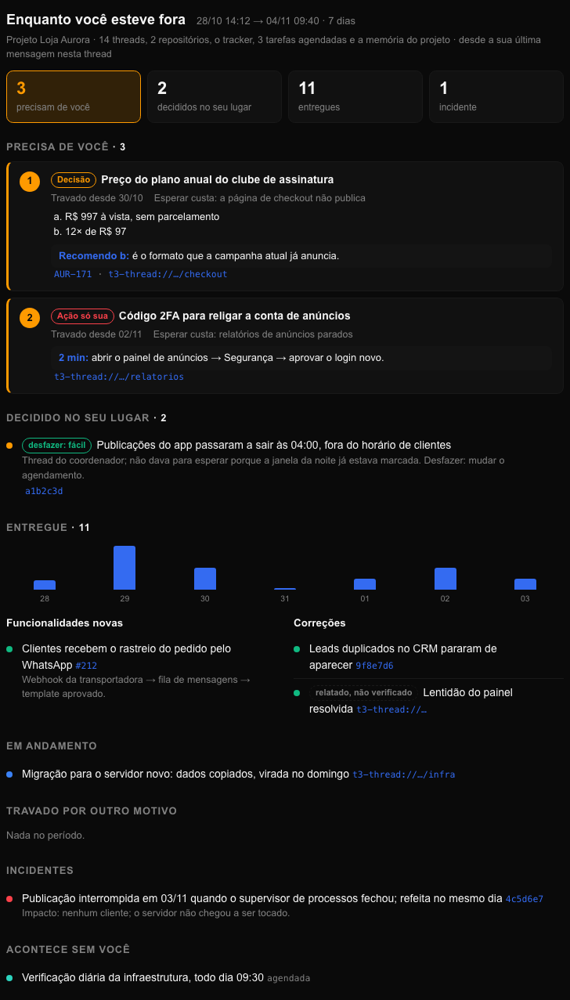

# /here

Uma skill para quem trabalha com muitos agentes autônomos e passa dias sem olhar um projeto.

Agentes entregam funcionalidades, corrigem bugs, passam trabalho de um para o outro, decidem coisas no seu lugar e travam esperando você. Quando você volta, não dá para ler dezenas de threads. Você digita `/here` e o agente faz duas coisas:

1. **Te atualiza** com uma página visual de tudo o que aconteceu desde a sua última mensagem: o que foi entregue, o que está em andamento, o que quebrou e o que segue rodando sem você.
2. **Te usa enquanto você está lá.** Ele lista, numerado e com recomendação, tudo o que só você destrava: decisões, aprovações, ações que só você pode fazer (senha, 2FA, pagamento) e decisões críticas que foram tomadas no seu lugar. Você responde `1 ok, 2 b, 3 depois`, e ele executa ou repassa cada resposta para o agente responsável na hora.



## Como funciona

1. **Janela de ausência.** Começa na sua última mensagem na thread. O T3 Code marca quem criou cada mensagem, então as mensagens de outros agentes e de tarefas agendadas não contam como presença sua. Você também pode passar a data: `/here desde 28/10` ou `/here 7d`.
2. **Escopo.** O projeto inteiro da thread, ou o que você pedir: `/here só esta thread`, `/here tudo`.
3. **Coleta, fonte a fonte, com prova:**
   - threads paradas esperando aprovação;
   - threads e delegados;
   - commits e PRs;
   - o tracker;
   - tarefas agendadas;
   - a memória do projeto.

   Cada item traz o commit, o PR, a issue ou o link da thread que o comprova. O que só um agente afirma aparece como "relatado, não verificado".
4. **Página.** Ela segue esta ordem:
   - **Precisa de você**
   - **Decidido no seu lugar**, com o custo de desfazer
   - **Entregue**, por dia e por tipo
   - **Em andamento**
   - **Travado por outro motivo**
   - **Incidentes**
   - **Acontece sem você**
5. **Sessão de desbloqueio.** Ele age sobre cada resposta sua enquanto você está presente.

## O rastro que os agentes deixam

O `/here` fica muito melhor quando os agentes marcam, no momento em que acontece, o que é seu. Acrescente isto ao `CLAUDE.md` e ao `AGENTS.md` globais:

```markdown
## Owner check-ins

The owner is often away from a project for days while agents keep working. Leave a trail he can catch up on:
- When you decide something that is his to decide, because waiting would block the work, write a line in your thread reply that starts with `Decidido sem o dono:`: what you chose, why it could not wait, and how to undo it.
- When work waits on him, write a line that starts with `Aguarda o dono:`: what is blocked and the exact answer or action you need. Keep working on everything that does not depend on it.
- When he arrives and types `/here` (`$here` on Codex) or asks what happened while he was away, use the `here` skill.
```

A skill busca essas duas marcas em todas as threads do projeto.

## Requisitos

- [T3 Code](https://github.com/pingdotgg/t3code), com as ferramentas de threads (`t3_thread_list`, `t3_thread_read`, `t3_thread_search`, `t3_thread_send`) e de página (`html_preview`, `html_render`). Sem `html_render`, a skill responde em Markdown.
- Claude Code ou Codex.
- Opcionais, usados quando existem: `gh` para PRs, o MCP do Linear para o tracker e [ai-memory](https://github.com/akitaonrails/ai-memory) para a memória do projeto.

## Instalação

```sh
git clone https://github.com/ogallotti/here-skill ~/dev/here-skill
ln -s ~/dev/here-skill/skills/here ~/.claude/skills/here   # Claude Code: /here
ln -s ~/dev/here-skill/skills/here ~/.agents/skills/here   # Codex: $here
```

## Adaptar

- **Idioma:** a skill escreve em português do Brasil. Troque a linha "Write everything the owner reads in Brazilian Portuguese" e as marcas `Decidido sem o dono:` e `Aguarda o dono:` para o seu idioma.
- **Visual:** a página usa as variáveis de tema do T3 e se ajusta ao claro e ao escuro. A estrutura e as regras ficam em `skills/here/page-template.html`.

---

**English.** `/here` is an owner check-in skill for T3 Code (Claude Code or Codex). When you come back after days away from a project run by autonomous agents, it builds a visual report of everything since your last message:
- **Needs you:** decisions, approvals and owner-only actions, numbered, each with a recommendation;
- **Decided on your behalf:** with the cost of undoing each one;
- **Shipped**, **in progress**, **incidents**, and **what keeps running without you**.

Every item cites its evidence. While you're there, it acts on your answers right away. Its output language is Brazilian Portuguese; change one line to switch.

Licença MIT.
